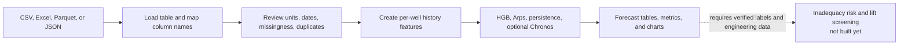

# GROUP Project ML: Predicting Natural-Flow Decline and Planning Artificial Lift

We are building a machine-learning workflow to study when a well’s natural flow may no longer meet an agreed production requirement. Our longer-term goal is to use production and reservoir history to help engineers assess artificial-lift timing and compare feasible lift options.

We want to be clear about what we have today: this repository is a research prototype. It can load and analyze tabular well data through Python notebooks and a FastAPI backend, forecast selected production and pressure targets, and compare several models. It does **not** yet identify a validated natural-flow transition, provide a dashboard or interactive question flow, or recommend an artificial-lift method. We explain below what we have built, how to run it with data, and what must be added before we can answer the lift-selection question responsibly.

## Contents

1. [What we are trying to answer](#what-we-are-trying-to-answer)
2. [What we built, from the first model to the current comparison](#what-we-built-from-the-first-model-to-the-current-comparison)
3. [Algorithms we use and why](#algorithms-we-use-and-why)
4. [What data the code accepts](#what-data-the-code-accepts)
5. [How to run it with our own well data](#how-to-run-it-with-our-own-well-data)
6. [FastAPI for a dashboard](#fastapi-for-a-dashboard)
7. [What information we need for an artificial-lift assessment](#what-information-we-need-for-an-artificial-lift-assessment)
8. [What the project returns](#what-the-project-returns)
9. [What the current field results tell us](#what-the-current-field-results-tell-us)
10. [Project files](#project-files)
11. [What is not built yet](#what-is-not-built-yet)
12. [Data sources, licensing, and privacy](#data-sources-licensing-and-privacy)
13. [Our next steps](#our-next-steps)
14. [References and contribution notes](#references-and-contribution-notes)

## What we are trying to answer

Our main question is: **using a well’s documented history and current conditions, can we forecast the rate and pressure trend, and can we estimate when natural flow will fall below a production requirement chosen for the project?**

Answering that question requires more than a declining oil-rate curve. We need to know the well’s reservoir and fluid context, how it is being operated, whether it is naturally flowing or already lifted, what interventions have occurred, and what “inadequate” means for the project. The eventual lift decision also depends on the well design, available power and gas, facilities, costs, and operating constraints.

The code we have now is the foundation for that work: tabular loading, column mapping, history features, regression forecasts, field-data checks, and model comparisons. We have not yet trained a model on labeled solution-gas-drive natural-flow transitions.

## What we built, from the first model to the current comparison

| Stage | What we added | Why we added it | What it demonstrates—and what it does not |
|---|---|---|---|
| 1. Reproducible data workflow | A canonical well-history format, file loading, column mapping, data checks, and per-well history features | Different field files use different names, dates, units, and frequencies. We needed one structure before we could compare wells. | Shows how data can be prepared. It does not automatically determine units or fix inconsistent measurements. |
| 2. Synthetic pipeline test | A small example with 36 artificial well histories and a configurable low-rate rule | We initially needed data to verify that the notebook, feature creation, model training, and charts ran end to end. | Tests software flow only. The generated values are not field observations and do not establish predictive accuracy. |
| 3. First machine-learning baseline | A `HistGradientBoostingRegressor` forecasting oil rate three monthly periods ahead, with grouped-well and time-based evaluation | Gradient boosting handles nonlinear relationships in tabular features and provides a practical baseline before attempting more complex models. | The three-month horizon and threshold are demo settings. It is not trained to predict a real lift-transition label. |
| 4. Real field benchmark | Equinor Volve daily production data for six producer wellbores, converted to a documented monthly panel; oil-rate and downhole-pressure forecasts | We needed a real-data test to reveal issues that synthetic data cannot show, including missing measurements and operational changes. | This is genuine field data, but it does not verify natural-flow/lift status or solution-gas-drive transition events. Volve used water-injection pressure support. |
| 5. Pretrained time-series comparison | Optional zero-shot Amazon Chronos-2 and Chronos-Bolt-Small forecasts | We wanted to see whether general pretrained time-series models offered a useful comparison without training their weights on this small field subset. | They are general-purpose models, not petroleum models. Their performance on one Volve well is not evidence of broad transfer. |
| 6. Arps decline comparison | Exponential, harmonic, and hyperbolic Arps curves, selected by AICc using the training history only | Arps is a familiar engineering decline baseline. It lets us compare a fitted decline trend with the data-driven and pretrained forecasts. | It models positive producing-rate decline. It does not model shut-ins, restarts, lift transitions, pressure support, or a recommended lift method. |
| 7. FastAPI backend | JSON and file-upload routes for Arps analysis; optional HGB training on a supplied multiwell dataset; chart-ready response data | We wanted a stable interface an interactive dashboard can call without embedding model code in the browser. | It is an API, not a dashboard. HGB models live in server memory, and no route recommends artificial lift. |

We keep the synthetic and real-field experiments separate. We do not combine their scores into one accuracy number.

## Algorithms we use and why

| Method | Role in this project | Why it is included | Important limitation |
|---|---|---|---|
| Lag, rolling, and trend feature engineering | Creates past-rate, pressure, and operating-history inputs separately within each well | Recent behavior and trajectory can contain useful information beyond a single current measurement. | Features are only as meaningful as the source columns, sampling intervals, units, and operating records. |
| Rule-based low-rate label | Demonstrates a user-configurable threshold and consecutive-period rule in the synthetic notebook | It makes the idea of “inadequate” explicit rather than pretending there is one universal threshold. | This is a rule, not a learned transition model, and it is not validated against field transition events. |
| `HistGradientBoostingRegressor` | Main tabular regression baseline for fixed-horizon oil-rate and downhole-pressure targets | It can represent nonlinear relationships and works with engineered tabular features. Numeric inputs are median-imputed with missingness indicators and scaled; categorical inputs are mode-imputed and one-hot encoded. | In the Volve holdouts, the original single-step model performed worse than persistence. The longer recursive comparison is a separate experiment. |
| Persistence | Predicts that the next rate or pressure will equal the latest observed value | A simple baseline tells us whether a more complicated method is adding value. | It is not a physical model and can fail badly after a shut-in, restart, intervention, or changing operating conditions. |
| Arps exponential, harmonic, and hyperbolic decline | Fits positive oil-rate observations; AICc chooses among the three curve forms using the context window | It provides an interpretable decline-curve baseline against the same holdout. | A smooth decline assumption does not describe changing well operation or zero-rate periods. The fitted curve parameters need engineering review. |
| Chronos-2 and Chronos-Bolt-Small | Optional zero-shot oil-rate forecasts from pretrained Hugging Face models | They provide an external time-series comparison without field-specific fine-tuning. | They are not trained for reservoir engineering; in this test, prediction intervals were under-covered and R² was negative. |
| MAE, RMSE, R², and interval coverage | Measures point forecast errors and checks how often observations fall inside model intervals | No single metric tells the whole story. We report errors in target units and compare with baselines. | These metrics assess the tested forecasts—not lift recommendations or future-field accuracy. There is no universal “accuracy percentage” for this regression task. |

For Arps, we fit the exponential equation `q(t) = qi * exp(-Di * t)` and the hyperbolic equation `q(t) = qi / (1 + b * Di * t)^(1 / b)`. Harmonic decline is the hyperbolic special case with `b = 1`; exponential fixes `b = 0`. Time and `Di` are expressed in months in the current script. The optimizer fits positive-rate history in log-rate space with robust least squares. Zero-rate months are omitted from the fit, although they remain part of the forecast evaluation.

We do **not** use a trained event classifier, survival model, neural network, or lift-selection algorithm in the current project. Some of these methods may be worth testing after we have enough correctly labeled field histories, but they are not part of the current results.

In the synthetic notebook, `NATURAL_FLOW_THRESHOLD = 10.0` source-rate units, `CONSECUTIVE_PERIODS = 2`, and `HORIZON = 3` monthly periods are illustrative code settings. They are there so we can see the pipeline run; they are not recommended operating limits. We must replace them with the project’s agreed units, criterion, and horizon before interpreting any output.

## What data the code accepts

The general table loader and FastAPI upload routes read **CSV, XLSX, XLS, Parquet, and JSON** files. The API reads a table; it does not infer arbitrary file formats, recognize every vendor schema, or decide what a column means. Scanned PDFs, images, and unsupported formats must first be converted into a structured table.

The generic baseline requires at least one row per well and date with these three canonical columns:

| Canonical column | Meaning | Required for the current generic notebook? |
|---|---|---:|
| `well_id` | Stable well identifier | Yes |
| `date` | Observation date, parseable as a date | Yes |
| `oil_rate` | Oil-rate target in a consistent, documented unit | Yes |
| `gas_rate`, `water_rate` | Gas and water production rates | No; useful when available |
| `reservoir_pressure`, `bhp` | Static/reservoir pressure and flowing downhole pressure, clearly distinguished | No; useful when available |
| `bubble_point_pressure`, `initial_reservoir_pressure` | PVT/reservoir context for pressure-depletion features | No; useful when available |
| `gor`, `water_cut`, `choke` | Derived/operating measurements | No; useful when available |
| `region`, `reservoir_type` | Documented categorical descriptors | No; do not infer these from a filename or location shortcut |
| `lift_active`, lift type, shut-in and intervention flags | Operating state through time | Not required by the baseline, but essential for the intended transition study |

The code can create `gor` from gas and oil rates and `water_cut` from water and oil rates when those columns are present and the corresponding derived values are not already supplied. It does not resolve engineering definitions for you. `normalize_columns` requires `well_id`, `date`, and `oil_rate`, parses dates, removes rows with missing dates or oil rate, and sorts the history. We must still inspect duplicate dates, gaps, missingness, rate allocation, and units ourselves. The `UNIT_MAP` in the notebook is a record/checklist; it does **not** perform unit conversion. We must convert incompatible units before combining data.

For the future solution-gas-drive task, we should retain both the raw source file and a cleaned table, document the source and units, and preserve explicit operating/event histories. These are not optional details if we want to tell natural depletion apart from shutdowns, facility limits, well interventions, or lift changes.

## How to run it with our own well data

There is no dashboard or interactive question-and-answer interface yet. In the notebook workflow, point `DATA_PATH` at your file and run the cells from top to bottom. The FastAPI backend also provides a file-upload endpoint for dashboard clients; see [FastAPI for a dashboard](#fastapi-for-a-dashboard) and the [API guide](docs/api_guide.md). The first notebook is the general pipeline demonstration; the second is specialized to the Volve workbook.

### 1. Install the project

From a terminal in the repository root:

```bash
python -m venv .venv
source .venv/bin/activate
pip install -r requirements.txt
jupyter lab
```

Open `notebooks/01_natural_flow_adequacy_baseline.ipynb`. For the optional Chronos model comparison, install `requirements-models.txt` separately and allow the first inference to download the model weights. We recommend starting with the base notebook and your own properly mapped data before installing those optional models.

### 2. Point the notebook at your file

Keep confidential company data outside this public repository, then set `DATA_PATH` to the file’s actual location. The notebook uses `load_table` for the supported table formats. Replace the demonstration `COLUMN_MAP` with the names in your own file. For example:

```python
DATA_PATH = "/path/to/our/well_history.xlsx"

COLUMN_MAP = {
    "Well Name": "well_id",
    "Production Date": "date",
    "Oil Rate (stb/d)": "oil_rate",
    "Gas Rate (mscf/d)": "gas_rate",
    "Water Rate (bbl/d)": "water_rate",
    "Flowing BHP (psi)": "bhp",
}

UNIT_MAP = {
    "oil_rate": "STB/day",
    "gas_rate": "Mscf/day",
    "water_rate": "bbl/day",
    "bhp": "psi",
}
```

These names are examples only; we must substitute the exact source headers and actual units from our file’s data dictionary. Mapping renames columns; it does not convert units. If our file stores year and month instead of a date, we need to construct a valid date column before calling the normalization step. If a data provider uses multiple sheets, the current generic loader reads the default sheet; we need to select the correct sheet explicitly in the notebook.

### 3. Answer the project’s analysis choices

Before training, we need to decide and document:

- Which wells and date range are included, and what one row represents (daily, monthly, test, or another interval).
- The rate unit and pressure unit for every source column, whether rates are measured or allocated, and how missing observations and duplicate well/date rows should be resolved.
- The forecast target and horizon—for example, oil rate one month ahead. The current field benchmark evaluates one-month predictions as well as a separate 21-month comparison for one well; those are different tests.
- If we are demonstrating the threshold label, the minimum acceptable rate in a stated unit and how many consecutive periods below that rate count as inadequate. This is a project-defined rule, not a model-discovered engineering limit.
- The reservoir type/drive mechanism and region only when they are documented or engineering-reviewed. Unknown values should remain unknown rather than being guessed.

The notebook displays missingness, duplicate well-date checks, data profiles, model scores, prediction tables, and charts. We should review those checks before interpreting a forecast. The held-out-well and forward-time splits in the notebook are for evaluation; they are not a substitute for validating a model on the specific new well or field we plan to use.

### 4. Run the field example or the Arps comparison

The real-field notebook runs on the included Volve data:

```text
notebooks/02_volve_real_field_benchmark.ipynb
```

It is a Volve-specific benchmark, not a general file-upload workflow. The standalone comparison script is also tied to the included Volve-format workbook. From the repository root, run:

```bash
python scripts/compare_arps_models.py
```

To run Arps, recursive HGB, persistence, Chronos-2, and Chronos-Bolt-Small together, use:

```bash
python scripts/compare_arps_models.py --include-hugging-face
```

Optional command-line arguments let us select a Volve-format workbook, well, training fraction, and output folder. This CLI is not a generic predictor for arbitrary uploaded field data; the notebook needs to be adapted to a new source, mapping, target, and unit definition first.

## FastAPI for a dashboard

The backend package is installable from the repository and exposes local REST endpoints. From the repository root:

```bash
python -m venv .venv
source .venv/bin/activate
python -m pip install -e ".[dev]"
sgd-api
```

By default, the server listens only on `127.0.0.1:8000`. Open [`http://127.0.0.1:8000/docs`](http://127.0.0.1:8000/docs) for Swagger and [`docs/api_guide.md`](docs/api_guide.md) for request and response examples. The package can also be installed with `pip install "git+https://github.com/Wizzy-pixel-ui/GROUP-project-ML.git"`; it has **not** been released to PyPI.

| Endpoint | What it does |
|---|---|
| `GET /health`, `GET /v1/capabilities` | Check service status and list available features. |
| `POST /v1/analyze` or `POST /v1/analyze/upload` | Submit one or more well histories as JSON or a supported tabular file. Returns history, an Arps and persistence curve, rate-trend summaries, and an observed threshold check. |
| `POST /v1/models/train` or `POST /v1/models/train/upload` | Train the current HistGradientBoosting model from a multiwell training set and return a single held-out-well validation summary. Requires at least four wells after exclusions. |
| `GET /v1/models/{model_id}` | Retrieve metadata for an HGB model still held in this API process. |

Pass `model_id` to `/v1/analyze` to include a fixed-horizon HGB prediction. Exclude the target well from training when testing generalization to an unseen well. `horizon_steps` counts rows, not calendar months, so it equals months only for complete monthly histories. HGB artifacts are currently in memory; they disappear on restart and are not shared between multiple worker processes.

Analysis responses contain arrays the frontend can plot directly. The API currently returns `three_d_available: false`: 3D well/reservoir animation needs well-survey coordinates, completion trajectory, and reservoir surfaces, none of which are included in our current inputs. The API also returns `artificial_lift.status = "not_implemented"` and `recommendation = null`; it does not recommend a lift method.

This backend has no authentication and is intended for local development. Do not expose it to the public internet or submit confidential data until authentication, HTTPS, access controls, request limits, privacy safeguards, and persistent model storage have been added. Project code is licensed under MIT; see [`LICENSE`](LICENSE). That license does not replace or change the separate terms for Volve data.

## What information we need for an artificial-lift assessment

Our notebooks and API do not ask these questions automatically. This is the information we should gather and verify before building a lift-screening feature:

| Question we need answered | Why it matters |
|---|---|
| What is the reservoir drive mechanism, and what source or engineering review confirms it? | A title or well name is not evidence of solution-gas drive. Drive mechanism changes the expected pressure and production behavior. |
| What are the initial/current reservoir pressures, bubble-point pressure, and available PVT/fluid properties? | These help characterize drawdown, gas liberation, fluid behavior, and inflow. Units and measurement dates matter. |
| What are the dated oil, gas, water, pressure, GOR, water-cut, and choke histories? | Rates alone may not distinguish reservoir decline from changed operation or changing fluid production. |
| When was the well naturally flowing, shut in, constrained, or on each artificial-lift method? When were workovers and other interventions performed? | These dates establish whether the model is learning depletion, operating choices, or transition outcomes. They are needed to label lift-transition examples. |
| What rate, drawdown, or economic limit defines “natural flow is inadequate” for this project? How long must the condition persist? | A threshold and decision window must be agreed and labeled; there is no single universal limit. |
| What is the completion and well geometry, including depth, tubing/casing sizes, deviation, restrictions, and wellhead/facility pressure? | Lift options have different design and operating envelopes. A decline curve cannot substitute for well design data. |
| Which resources and constraints are available—power, gas for gas lift, injection/flowline capacity, water handling, space, maintenance, safety, and budget? | Technical production potential may not be feasible or economic under the actual field constraints. |
| For wells that already transitioned, what method was installed, when, why, and what happened to production, uptime, cost, and failures? | We need labeled outcomes and comparison cases to evaluate any future method-ranking model. |

A future lift-assessment workflow should return a **screening result with evidence**, not a bare answer: forecast range, threshold-crossing probability/time only after it is validated, candidate methods that pass documented constraints, reasons for ruling options in or out, assumptions, uncertainty, and a clear “insufficient data / engineering review required” state. We have not built that decision-support step yet. Lift choice should not be inferred from production decline alone.

## What the project returns

| Where we run it | What we see or save |
|---|---|
| Synthetic baseline notebook | A data-quality check, an example rule-based inadequate-flow label, fixed-horizon oil-rate predictions, held-out-well and time-split regression metrics, tables, and diagnostic charts. Synthetic results are software demonstrations only. |
| Volve field notebook | Real-data profiles, oil-rate and downhole-pressure regression metrics, held-out-well/time comparisons, prediction tables, Chronos forecasts and intervals when the optional package is available, plus the Arps comparison and chart. |
| `compare_arps_models.py` | `arps_model_comparison_metrics.csv`, `arps_model_comparison_predictions.csv`, `arps_model_comparison_metadata.json`, and `arps_model_comparison.png` under `reports/arps_comparison/`. |
| FastAPI backend | JSON/file-upload analysis, chart-ready history and forecast arrays, optional HGB predictions, a transparent threshold check, and an explicit no-lift-recommendation status. |

The project reports **MAE and RMSE** in the target’s source units, **R²** as context, forecast rows, and Chronos interval coverage where available. It does not report a universal “accuracy percentage,” calibrated natural-flow inadequacy probability, or recommended lift system.

Here is the current workflow, including the step we have **not** built yet:



## What the current field results tell us

We included the Volve workbook to test the pipeline on real observations, not to claim that it represents our target reservoir type. The subset has 9,143 daily producer records across six wellbores. Volve was developed with water injection for pressure support; the workbook does not provide verified natural-flow/artificial-lift status or a transition event.

The table below is one fixed 21-month forecast for one Volve well, 15/9-F-12. Its long test period includes a zero-rate month, a restart, and later low/zero production. Every model’s R² is negative on this selected horizon. The numbers are evidence about this test only—not expected accuracy on our wells.

| Model on the same 21-month holdout | MAE | RMSE | R² |
|---|---:|---:|---:|
| Arps exponential (selected using training-only AICc) | 301.68 | 355.72 | -1.51 |
| Recursive HistGradientBoosting | 207.11 | 261.55 | -0.35 |
| Chronos-Bolt-Small median | 275.04 | 343.65 | -1.34 |
| Chronos-2 raw median | 507.10 | 526.06 | -4.48 |
| Chronos-2 median clipped at zero | 387.52 | 446.67 | -2.95 |
| Persistence | 388.97 | 449.20 | -3.00 |

Recursive HGB had the lowest MAE in this one comparison, followed by Chronos-Bolt and Arps. Chronos intervals were also under-calibrated on this holdout: the nominal 80% Chronos-Bolt interval covered 66.7% of values, while Chronos-2 covered 19.0%. We do not treat any of these results as field-ready performance.

The earlier one-step Volve benchmarks tell a related but separate story: HGB’s oil-rate MAE was 293.67 versus 104.35 for persistence on a held-out well, and 140.27 versus 52.99 on a purged later-time split. HGB pressure MAE also exceeded persistence on those selected splits. Read the full split definitions and limitations in [`docs/volve_field_results.md`](docs/volve_field_results.md).

## Project files

```text
.
├── README.md
├── LICENSE
├── pyproject.toml
├── configs/project.yaml
├── data/
│   ├── synthetic/demo_well_monthly.csv
│   ├── raw/volve/Volve production data.xlsx
│   └── processed/volve_daily_producers.csv
├── docs/
│   ├── arps_method.md
│   ├── api_guide.md
│   ├── dashboard_generation_prompt.md
│   ├── volve_data_and_license.md
│   ├── volve_field_results.md
│   ├── huggingface_models.md
│   ├── canonical_schema.csv
│   └── data_provenance.csv
├── notebooks/
│   ├── 01_natural_flow_adequacy_baseline.ipynb
│   └── 02_volve_real_field_benchmark.ipynb
├── scripts/compare_arps_models.py
├── reports/arps_comparison/
│   ├── arps_model_comparison_metrics.csv
│   ├── arps_model_comparison_predictions.csv
│   ├── arps_model_comparison_metadata.json
│   └── arps_model_comparison.png
├── src/sgd_ml/
│   ├── io.py
│   ├── features.py
│   ├── labels.py
│   ├── modeling.py
│   ├── volve.py
│   ├── arps.py
│   └── arps_comparison.py
├── src/sgd_api/             # FastAPI routes, schemas, analysis, and HGB model registry
├── requirements.txt
├── requirements-models.txt
└── tests/                   # Includes API and modeling tests
```

## What is not built yet

- We do not have a field-validated classifier or time-to-event model for natural-flow inadequacy.
- We do not have a confirmed set of solution-gas-drive wells with dated natural-flow-to-lift transitions and censored histories.
- We do not have a dashboard or interactive assistant that asks engineering questions and returns a lift recommendation. The API has file-upload endpoints, but it is a backend service—not a GUI or engineering questionnaire.
- We do not rank ESP, gas lift, rod pump, PCP, hydraulic lift, or other systems. No such model has been trained or tested here.
- We do not automatically convert units, infer arbitrary vendor headers, verify regular cadence, identify a drive mechanism, or infer lift status. The API rejects duplicate well/date rows; it does not resolve or aggregate them for us.
- Chronos models are optional generic forecasts; their weights are downloaded when used and are not stored in this repository.

These gaps matter because a numerical forecast is not a lift design. To build the intended recommendation carefully, we first need representative, well-documented field histories with actual transition outcomes and enough engineering/facility/economic inputs to compare methods.

## Data sources, licensing, and privacy

The project code is licensed under MIT (see [`LICENSE`](LICENSE)). This code license does **not** apply to third-party data. The repository includes a small Volve workbook and a derived producer panel. We retain the original source workbook and cite Equinor’s Volve terms in [`docs/volve_data_and_license.md`](docs/volve_data_and_license.md); redistribution requires attribution and the source license prohibits sale. The Norwegian Offshore Directorate’s field context explains why Volve should not be described as a direct solution-gas-drive natural-flow-transition dataset.

Other identified sources are not included as field transition examples merely because they contain production data. Some require login, have limited variables, focus on another reservoir type, or lack the drive-mechanism and lift labels our question requires. The data-provenance table records these limits.

This is a public repository. **Do not place confidential company data here or commit it to GitHub.** Keep private data in an approved local or controlled workspace, point `DATA_PATH` to that file, and share only non-sensitive results. Check the license and attribution requirements for every external dataset before copying it into a public repository.

## Our next steps

1. Agree on a measurable definition of inadequate natural flow, including rate units, duration, and decision horizon.
2. Obtain field histories with verified solution-gas-drive classification, natural-flow/lift status over time, transition dates, interventions, and end-of-observation/censoring information.
3. Add a robust data-intake and validation layer that produces a mapping/unit/missingness report before modeling; keep source-specific adapters separate from the canonical format.
4. Benchmark simple engineering and statistical baselines on repeated well-held-out and time-held-out datasets. Report uncertainty and calibration, not just point errors.
5. Build and validate time-to-inadequacy estimates only after event labels are adequate.
6. Add a separate engineering feasibility and economics workflow for lift screening, with explicit constraints, traceable reasons, uncertainty, and engineer review. Do not label that output an automated recommendation until it has been evaluated against real outcomes.

## References and contribution notes

- [Equinor Volve Data Sharing](https://www.equinor.com/energy/volve-data-sharing)
- [Norwegian Offshore Directorate field summary for Volve](https://www.norskpetroleum.no/en/facts/field/volve/)
- [Amazon Chronos-2 model card](https://huggingface.co/amazon/chronos-2)
- [Amazon Chronos-Bolt-Small model card](https://huggingface.co/amazon/chronos-bolt-small)
- [SPE Data Repository](https://www.spe.org/en/industry/data-repository/)

We welcome contributions that improve unit handling, add documented field datasets with suitable rights, test additional engineering baselines, and strengthen validation. Please keep raw-data provenance and the limits of every result visible when adding a new source or model.
